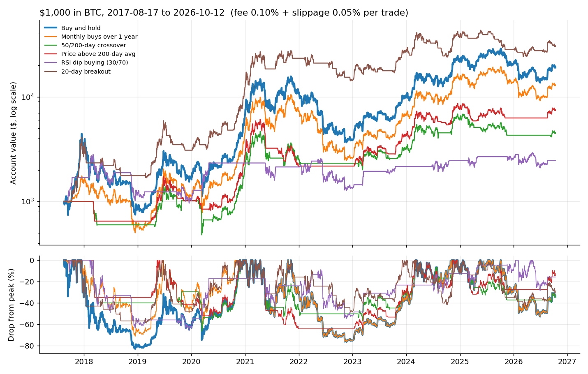

# BTC Backtester

Can a simple trading rule beat just buying Bitcoin and holding it?

This tool tests six classic strategies on daily BTC/USDT history since 2017,
with trading fees and slippage on every trade, and compares each one with
buy-and-hold on return, worst drop and risk-adjusted return. Then it runs an
**overfitting test**: it tunes a strategy on the past and checks whether the
"best" settings still work on years they've never seen.

Paper only. It never places a trade.

> Follow-up to [arb-reality-check](https://github.com/anubhav0089/arb-reality-check),
> where I tested a viral arbitrage claim against live market data.

---

## Strategies

| Strategy | Rule |
|---|---|
| Buy and hold | Buy on day one, never sell. The benchmark. |
| Monthly buys over 1 year | Invest 1/12 of the money each month for a year, then hold. |
| 50/200-day crossover | Hold BTC while the 50-day average is above the 200-day average. |
| Price above 200-day avg | Hold BTC while the price is above its 200-day average. |
| RSI dip buying (30/70) | Buy when 14-day RSI drops below 30, sell when it rises above 70. |
| 20-day breakout | Buy a new 20-day high, sell a new 20-day low. |

## What's reported

| Column | Meaning |
|---|---|
| Final $ / Total / Per year | Ending value of $1,000, total return, and compound annual return |
| Worst drop | Largest fall from a previous high (max drawdown) |
| Sharpe | Return per unit of day-to-day volatility; higher means a smoother ride |
| Trades / Fees $ | Number of trades and what fees plus slippage cost |
| In market | Share of days holding BTC |
| vs hold | Beat buy-and-hold, less return but smoother, or worse |

Plus a chart of account value (log scale) and drawdown for every strategy.

## Rules that keep it honest

- **No look-ahead.** A signal is calculated from data up to day *t*'s close and executed at day *t+1*'s **open**. A test proves a strategy can't profit from the day it was decided on.
- **Costs on every trade.** 0.1% exchange fee + 0.05% slippage by default, both adjustable.
- **No hidden rebalancing.** The engine only trades when a strategy's signal changes.
- **Warm-up history.** With `--start`, the 200-day averages use the data before that date, so every strategy is ready on day one.
- **Out-of-sample testing.** `--optimize` keeps the most recent 40% of history hidden while tuning.

## Results

### $1,000 in BTC, 17 Aug 2017 to 12 Oct 2026

Daily Binance data (3,344 days), 0.1% fee + 0.05% slippage per trade.

| Strategy | Final $ | Per year | Worst drop | Sharpe | Trades | In market | vs hold |
|---|---:|---:|---:|---:|---:|---:|---|
| 20-day breakout | 30,271 | +45.1% | −59% | 1.01 | 67 | 58% | beat it |
| **Buy and hold** | **19,073** | **+38.0%** | **−83%** | **0.82** | 1 | 100% | |
| Monthly buys over 1 year | 12,810 | +32.1% | −77% | 0.77 | 12 | 100% | worse |
| Price above 200-day avg | 7,413 | +24.4% | −64% | 0.73 | 65 | 49% | worse |
| 50/200-day crossover | 4,484 | +17.8% | −67% | 0.59 | 19 | 49% | worse |
| RSI dip buying (30/70) | 2,472 | +10.4% | −66% | 0.44 | 28 | 41% | worse |



**What it shows**

- Buy-and-hold made 19× but fell **83%** from its peak along the way, which
  very few people actually sit through.
- Four of the five rules did worse than holding. The popular 50/200-day
  "golden cross" kept less than a quarter of holding's gain.
- RSI dip buying, which looked brilliant on random demo prices, came last on
  real data.
- The 20-day breakout beat holding on return, worst drop and Sharpe, mostly
  by sitting in cash through the big crashes. So I stress-tested it.

### Does the breakout's win hold up?

| Test | Breakout | Buy and hold | Breakout wins? |
|---|---:|---:|---|
| Full history, 0.1% fee | $30,271 (Sharpe 1.01) | $19,073 (0.82) | yes |
| Full history, **0.2% fee** | $28,310 (1.00) | $19,054 (0.82) | yes |
| **From 1 Jan 2021**, 0.1% fee | $2,421 (0.57) | $2,786 (0.60) | **no** |

Doubling fees barely hurt it, so costs weren't flattering it. But starting
in 2021 it **lost to holding** on both return and Sharpe. Its whole lead
came from 2017–2020, mostly from sitting out the 2018 crash.

From 2021, *no* strategy beat holding on return. "Price above 200-day avg"
came closest ($2,620, Sharpe 0.61 vs 0.60) with a smaller worst drop
(−64% vs −77%), so its one real benefit was a calmer ride, not more money.

**Conclusion:** the full-period winner was a product of which years I
tested. A result that disappears when you move the start date is not an
edge.

### Overfitting test

I tuned the moving-average crossover (31 fast/slow combinations) on
**Aug 2017 to Feb 2023**, then ran the top 5 on **Feb 2023 to Oct 2026**,
which they had never seen.

| Fast | Slow | Tuning period $ | Hold, tuning $ | Unseen period $ | Hold, unseen $ |
|---:|---:|---:|---:|---:|---:|
| 5 | 50 | 13,873 | 5,076 | 3,360 | 3,753 |
| 10 | 50 | 12,696 | 5,076 | 2,397 | 3,753 |
| 30 | 50 | 12,574 | 5,076 | 1,719 | 3,753 |
| 5 | 100 | 11,055 | 5,076 | 3,282 | 3,753 |
| 20 | 50 | 7,326 | 5,076 | 2,148 | 3,753 |

All five "winners" beat holding by up to **2.7×** in the tuning period, and
**all five lost to holding** on the unseen years. The settings that did best
on unseen data had ranked only **#16 of 31** during tuning.

That's overfitting: the tuning found settings that fit the past's random
wiggles, not a pattern that repeats. It's the main reason a backtest that
looks amazing usually disappoints live, and why strategy sellers who show
only a backtest are showing you the least useful number.

## A warning the demo makes for me

`--demo` runs everything on **random prices**: a random walk with no pattern
in it at all. On that data, "RSI dip buying" turned $1,000 into about $10,000
while buy-and-hold made 41%.

There was nothing to find, and a strategy "found" it anyway. One backtest that
beats the market proves very little. That's why this tool includes an
out-of-sample test.

---

## Run it

Needs Python 3.9+. On a Mac, use `python3`.

```bash
git clone https://github.com/anubhav0089/btc-backtester.git
cd btc-backtester
python3 -m pip install -r requirements.txt

python3 backtest.py                       # downloads history once, runs everything
python3 backtest.py --start 2021-01-01    # test a recent period only
python3 backtest.py --optimize            # overfitting test
python3 backtest.py --fee 0.0005          # different costs
python3 backtest.py --demo                # random prices, offline
```

The first run downloads every daily candle from Binance (falling back to
Bybit, then OKX) into `data/btc_usdt_1d.csv`. Use `--refresh` to update it.
Charts and CSV summaries go into `results/`.

| Option | Default | Meaning |
|---|---|---|
| `--start`, `--end` | all history | Date range to test (`YYYY-MM-DD`) |
| `--capital` | 1000 | Starting dollars |
| `--fee` | 0.001 | Fee per trade (0.001 = 0.1%) |
| `--slippage` | 0.0005 | Slippage per trade |
| `--optimize` | off | Run the overfitting test |
| `--split` | 0.6 | Share of history used for tuning in `--optimize` |
| `--refresh` | off | Re-download price history |
| `--demo` | off | Random prices for testing |
| `--no-chart` | off | Skip the chart |

### Tests

```bash
python3 -m pip install pytest
python3 -m pytest -q
```

## Add your own strategy

A strategy is a function that takes the price history and returns one number
per day: `0` for all cash, `1` for all BTC, anything in between for a partial
position. Day *t*'s number may only use data up to day *t*.

```python
def weekends_only(b):
    """Example: hold BTC only on weekends."""
    from datetime import datetime
    return [1.0 if datetime.strptime(d, "%Y-%m-%d").weekday() >= 5 else 0.0
            for d in b.date]

STRATEGIES["Weekends only"] = weekends_only
```

## Limitations

- Daily bars only; no intraday stops or fills.
- Long or cash only; no shorting or leverage.
- Taxes and the exchange's spread on large orders aren't modelled.
- Past performance, especially from one asset's history, doesn't predict the future.

Educational project, not financial advice.

## License

MIT
